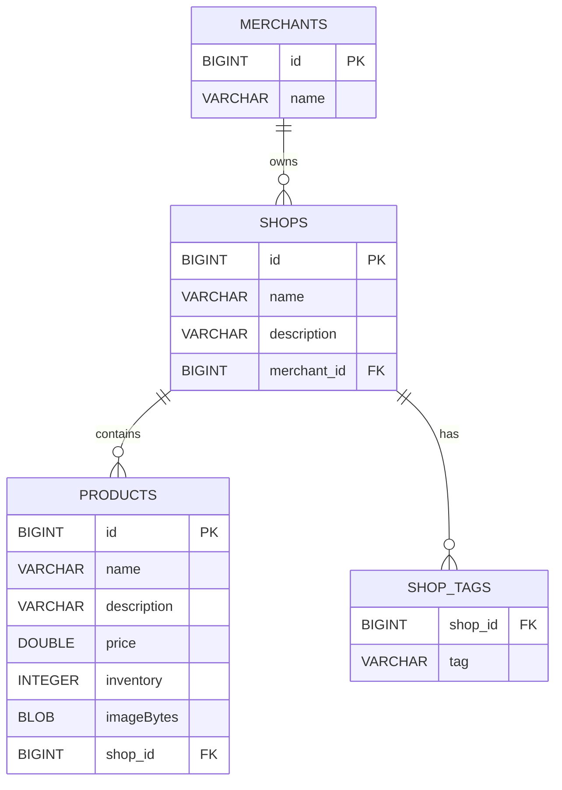

# Milestone 1 Database Schema

The Milestone 1 database structure is generated from the current JPA entity mappings.

## Relationships

- One merchant can own multiple shops.
- Each shop belongs to one merchant through `merchant_id`.
- One shop can contain multiple products.
- Each product belongs to one shop through `shop_id`.
- A shop can contain multiple tags, stored in the `shop_tags` collection table.
