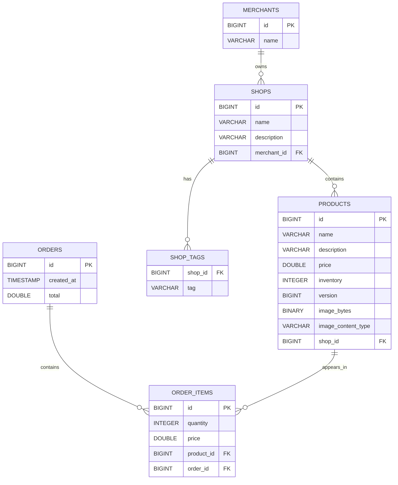

# Milestone 2 Database Schema

This logical schema reflects the JPA entities and relationships in the Mini-Shopify application as of Milestone 2. Hibernate generates the physical database structure from those mappings; exact SQL column types may differ between H2 (local/tests) and PostgreSQL (Azure).

## Relationships

- **Merchant → Shop:** One merchant can own multiple shops; each shop references its merchant through `shops.merchant_id`.
- **Shop → Product:** One shop can contain multiple products; each product references its shop through `products.shop_id`.
- **Shop → Tags:** Shop tags are stored in the `shop_tags` element-collection table, whose `shop_id` references a shop. A shop can have multiple tags.
- **Order → OrderItem:** One order can contain multiple order items; each order item references its parent order through `order_items.order_id`.
- **Product → OrderItem:** One product may appear in multiple order items; each order item references the purchased product through `order_items.product_id`.

## Milestone 2 additions and behavior

- **Orders:** The `orders` table stores an order's generated ID, creation timestamp (`created_at`), and total.
- **Order items:** The `order_items` table stores the quantity, the purchase-time unit price, and foreign keys to both the order and product. Saving a new `Order` persists its associated `OrderItem` entities via `CascadeType.PERSIST`.
- **Inventory:** The `products.inventory` column is reduced when checkout succeeds. The checkout service is `@Transactional`, so database updates are committed together or rolled back on a transaction failure.
- **Optimistic locking:** `products.version` is mapped with JPA `@Version` to detect conflicting updates.
- **Product images:** `products.image_bytes` and `products.image_content_type` store the image data and MIME type. The binary column's exact SQL type is database-specific.
- **Session cart:** `Cart` is `@SessionScope` and keeps product IDs and quantities in memory for each HTTP session. It is **not** a database table. The cart is cleared after a successful checkout, outside the database transaction.

**Note:** This document describes the intended JPA-mapped schema, not a verified snapshot of the live Azure database. Existing PostgreSQL deployments may require a migration for newly added columns.
