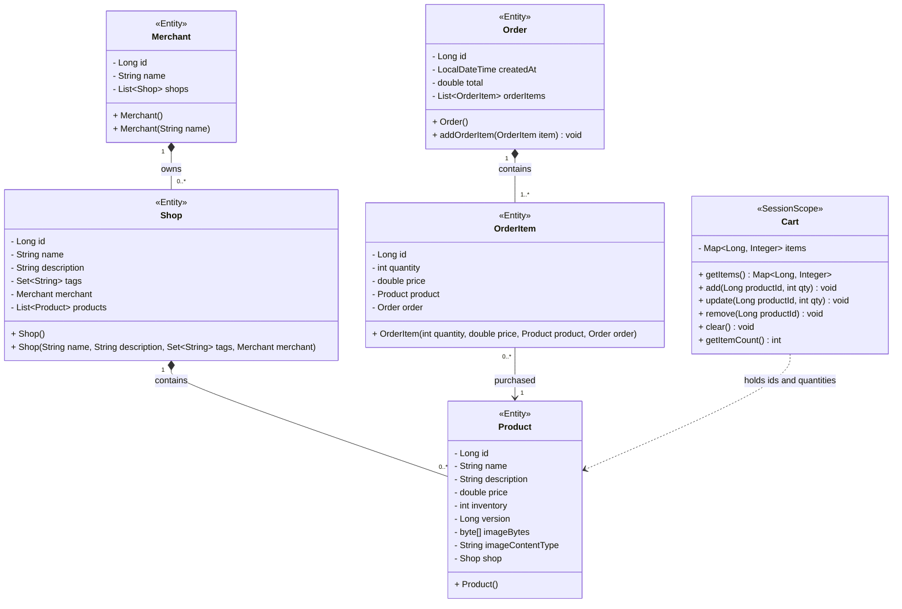
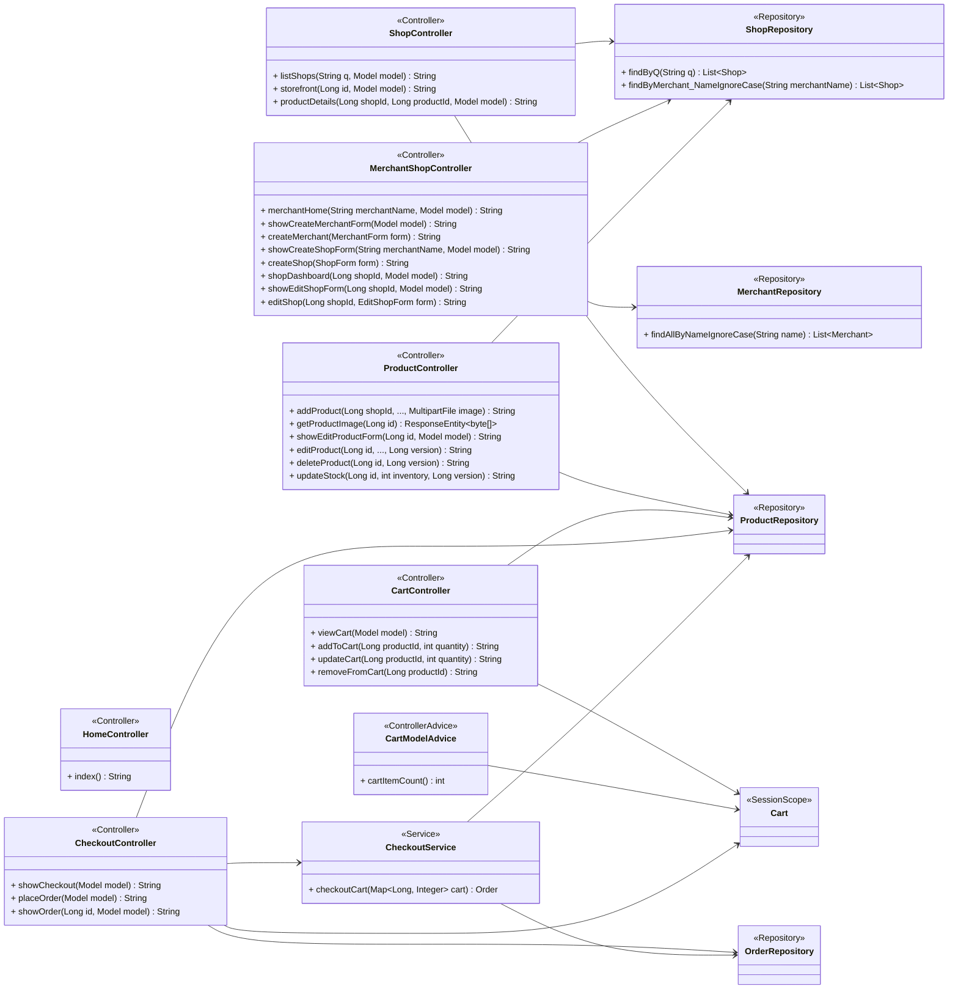

# UML Diagrams (Milestone 2)

These diagrams reflect the code currently on `main`. Getters and setters are omitted.

## Domain model

Notes:
- `Product.version` is a JPA `@Version` field, used for optimistic locking when stock changes.
- `OrderItem.price` stores the price at the time of purchase, so later price changes don't affect past orders.
- `Cart` is not a database entity. It lives in the HTTP session and maps product IDs to quantities.

## Application layers

All repositories extend `JpaRepository<Entity, Long>`. `CheckoutService.checkoutCart` is `@Transactional`: it checks every item's stock, decrements inventory, and saves the order, and if any item is out of stock, the whole checkout rolls back.

## Routes

| Controller | Method | Path | Purpose |
|---|---|---|---|
| HomeController | GET | `/` | Landing page |
| ShopController | GET | `/shops?q=` | List shops, search by name or tag |
| ShopController | GET | `/shops/{id}` | Storefront |
| ShopController | GET | `/shops/{shopId}/products/{productId}` | Product details |
| MerchantShopController | GET | `/merchant/home?merchantName=` | Merchant home, lists their shops |
| MerchantShopController | GET | `/merchant/new` | Create merchant form |
| MerchantShopController | POST | `/merchant/merchants` | Create merchant |
| MerchantShopController | GET | `/merchant/shops/new` | Create shop form |
| MerchantShopController | POST | `/merchant/shops` | Create shop |
| MerchantShopController | GET | `/merchant/shops/{shopId}/dashboard` | Shop dashboard |
| MerchantShopController | GET / POST | `/merchant/shops/{shopId}/edit` | Edit shop |
| ProductController | POST | `/merchant/shops/{shopId}/products` | Add product with image |
| ProductController | GET | `/merchant/products/{id}/image` | Serve product image |
| ProductController | GET / POST | `/merchant/products/{id}/edit` | Edit product |
| ProductController | POST | `/merchant/products/{id}/delete` | Delete product |
| ProductController | POST | `/merchant/products/{id}/stock` | Update inventory |
| CartController | GET | `/cart` | View cart |
| CartController | POST | `/cart/add`, `/cart/update`, `/cart/remove` | Change cart contents |
| CheckoutController | GET / POST | `/checkout` | Review cart / place order |
| CheckoutController | GET | `/orders/{id}` | Order confirmation |
